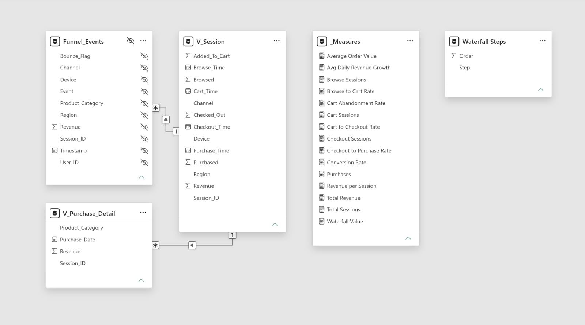

# Marketing Funnel & Conversion Analysis

Most online sessions never end in a purchase. This project uses SQL Server and Power BI to show where sessions drop off in the funnel, which channels, devices and regions convert best, and how revenue is spread.

**[View the Live Dashboard](https://app.powerbi.com/view?r=eyJrIjoiNTA4YzllZWUtOGM1Ni00Yjg3LWJmZGQtOTBlNWI3ZmU0MDhkIiwidCI6IjNjYmNmZWY2LWUxZGEtNDEyNy04Nzg0LTAyZmQ1ZmJkMWZlNCJ9&pageName=989e1ba029e5d9fa77c8)** | **[Power BI File](Marketing_Funnel_Conversion_Analysis.pbix)**


> Only about 1 in 10 sessions ends in a purchase. The biggest loss happens at checkout and payment, channels, devices and regions convert at similar rates, and revenue is spread evenly across categories. The dashboard is interactive: use the Channel, Device and Region slicers to explore.

---

## Background and Overview

A marketing team needs to know where visitors are lost on the way to a purchase and which traffic segments are worth more. This project analyses session-level funnel data from **October 2025** to answer four questions:

1. At which stage do sessions drop off?
2. How do channels, devices and regions compare on conversion?
3. Which categories, regions and channels drive revenue?
4. How has revenue trended through the month?

**Dashboard pages**

| Page | Question it answers |
|------|---------------------|
| 1. Funnel Overview | At which stage do sessions drop off, and how do channels, devices and regions compare? |
| 2. Segments & Revenue | Which categories, regions and channels drive revenue, and how has it trended? |

**Workflow:** Data check (SQL) → Views and analysis queries (SQL) → Dashboard (Power BI, DAX)

**Key definitions**
- **Funnel stages:** Browse → Add to Cart → Checkout → Purchase
- **Conversion Rate** = Purchases / Total Sessions
- **Cart Abandonment Rate** = (Sessions that added to cart − Purchases) / Sessions that added to cart
- **Average Order Value** = Total Revenue / Purchases
- **Revenue per Session** = Total Revenue / Total Sessions
- **Avg Daily Revenue Growth:** average daily revenue in the second half of the month compared with the first half

---

## Data Structure Overview





**Data model in Power BI**
- `V_Session` is the main table. The Channel, Device and Region slicers use its columns.
- `V_Purchase_Detail` and the raw `Funnel_Events` table connect to `V_Session` through `Session_ID` (many rows to one session), so the slicers filter purchase details as well. `Funnel_Events` is hidden because the analysis uses the two views.
- `Waterfall Steps` is a small helper table for the funnel waterfall and is not connected to the other tables.
- `_Measures` holds the DAX measures for the KPIs, stage conversion rates and revenue growth.

**Raw data:** event-level, with one row for each stage a session reached. It has 21,663 rows covering 10,000 sessions between 1 and 31 October 2025.

| Event | Rows |
|-------|------|
| Browse | 10,000 |
| Add to Cart | 7,059 |
| Checkout | 3,524 |
| Purchase | 1,080 |

| Area | Columns |
|------|---------|
| Identifiers | `User_ID`, `Session_ID` |
| Event | `Event`, `Timestamp` |
| Segments | `Channel`, `Device`, `Region` |
| Product and revenue | `Product_Category`, `Revenue` (only Purchase events have revenue) |
| Not used | `Bounce_Flag` |

**Views created in SQL**

| View | Meaning |
|------|---------|
| `v_session` | One row per session with a 0/1 flag for each stage reached, plus channel, device, region and revenue |
| `v_purchase_detail` | One row per purchase with purchase date, product category and revenue |

**Data note:** Channel, device and region can differ between the events of the same session. To count each session in only one segment, the analysis takes these three values from the Browse event. Product category comes from the Purchase event.

**Data checks (SQL):** missing values, and revenue that is invalid (a purchase with zero or negative revenue, or revenue on a non-purchase event).

---

## Executive Summary

Only about 1 in 10 sessions ends in a purchase (10.8%), and 85% of sessions that add to cart never buy. Three findings explain the picture:

- **The funnel leaks after the cart.** Half of the carts never reach checkout, and only about 3 in 10 sessions that reach checkout complete the payment.
- **Channels, devices and regions are close to each other.** Conversion stays within about one percentage point across segments, so the stage of the funnel matters more than where the session comes from. Email is the weakest channel.
- **Revenue is spread evenly.** No single category or region carries the business, so growth has to come from conversion and order value.

---

## Insights Deep Dive

### 1. Funnel Overview: where do sessions drop off?


**Insight:** The biggest losses are after the cart, at checkout and payment.

- Of 10,000 sessions, 1,080 end in a purchase. The largest drop is between cart and checkout (3,535 sessions), and the weakest step rate is checkout to purchase (30.6%).
- Channels are close. Organic converts best (11.2%) and Email is lowest (10.2%).
- Email has the best cart-to-checkout rate (50.4%) but the weakest checkout-to-purchase rate (29.0%), so its visitors start checkout but do not finish.
- Desktop converts best (11.2%) and Tablet is lowest (10.4%). The best combination is Desktop with Google Ads (12.0%), and the weakest is Tablet with Email (9.7%).
- South and East convert slightly better than North and West.
- The differences between segments are small, so treat them as hints to test, not proven gaps.

The main opportunity is the checkout and payment step, not switching channels.

### 2. Segments & Revenue: what drives revenue?


**Insight:** Revenue is evenly spread, and the segments that convert better also earn more.

- Total revenue is ₹1,176,406 with an average order value of ₹1,089 and ₹117.64 per session.
- All five categories earn a similar share (each about one-fifth). Electronics is the highest and Beauty is the lowest.
- Regions earn in the same order as they convert: South and East first, then North and West.
- Organic and Google Ads earn the most per session (about ₹122), and Email earns the least (₹110.93). Email is weakest on both conversion and revenue per session.
- Daily revenue moves up and down through the month without a clear trend. Average daily revenue in the second half of the month is 4.2% higher than in the first half. The first and last days look low because the data starts and ends part-way through the day.

There is no single star category or region to depend on. Better conversion and a stronger Email experience are the clearest ways to add revenue.

---

## Recommendations

| Finding | Action |
|---------|--------|
| Biggest weakness is checkout to purchase | Review the checkout and payment steps (payment options, number of steps, errors) |
| Half of the carts never reach checkout | Add cart reminders and follow-up for sessions that add to cart but do not continue |
| Email has the weakest payment step and the lowest revenue per session | Review Email landing pages and offers, and check the checkout experience for Email visitors |
| Weak combinations such as Tablet with Email and Mobile with Social Media | Check the experience for these device and channel combinations |
| Organic and Google Ads earn the most per session | Keep investing in them and use them as the benchmark for other channels |

Segment differences are small, so test changes with A/B tests before scaling them.

---

## Repository and How to Run

```
├── Assets/                           # Dashboard screenshots and data model
│   ├── Data_Model.jpeg
│   ├── Funnel_Overview.png
│   └── Segment_Revenue.png
├── Data/
│   └── Funnel_Analysis_Data.csv
├── Funnel_Analysis.sql
├── Marketing_Funnel_Conversion_Analysis.pbix
└── README.md
```

1. In SQL Server, create a database named `MarketingFunnelDB`
2. Import `Data/Funnel_Analysis_Data.csv` as the table `dbo.funnel_events`
3. Run `Funnel_Analysis.sql` to run the data check, create the two views and see all analysis queries
4. Open `Marketing_Funnel_Conversion_Analysis.pbix` in Power BI Desktop (refresh the data source if it asks for the server details)

**Tools:** SQL Server (T-SQL), Power BI, DAX

---

Thank you for reading. If you liked this project, a ⭐ on the repository would be appreciated, and feedback is always welcome.

**Khushi Nandha** | [LinkedIn](https://www.linkedin.com/in/khushi-nandha) | [GitHub](https://github.com/KhushiNandha)